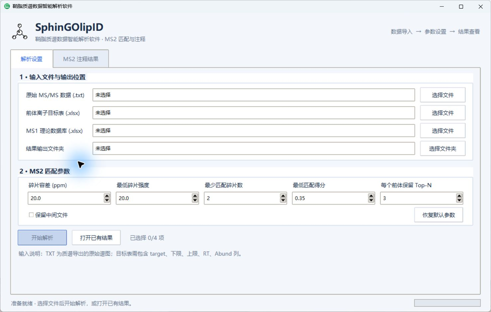
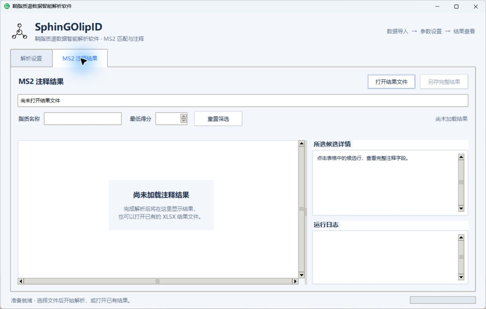

# GUI Guide

The Tkinter desktop GUI uses the current MS2 backend. Start it with
`python -m sphingolipid_toolkit.gui` or the installed `sphingolipid-gui` command.

## Desktop workflow

The app opens directly on **解析设置**. Select the original MS/MS TXT file,
precursor target XLSX table, MS1 theoretical database, and output folder. Full
paths appear beside each selection. **开始解析** becomes available after all
four selections are supplied; missing files and invalid parameters are reported
before a worker is started.

The five editable matching parameters use the backend defaults: fragment
tolerance `20 ppm`, minimum fragment intensity `20`, minimum matched fragments
`2`, minimum MS2 score `0.35`, and Top-N `3`. **恢复默认参数** restores these
values. **保留中间文件** controls intermediate-file retention.

During processing, the footer shows the current backend stage and elapsed time.
The activity bar indicates work in progress; it does not estimate a completion
percentage. Inputs and parameters are locked for the current run. Switching
between tabs preserves the result view and logs.

The **MS2 注释结果** tab opens the completed file automatically and also accepts
existing XLSX results via **打开已有结果** / **打开结果文件**. It provides:

- case-insensitive, literal lipid-name search;
- minimum-score filtering, with a blank threshold showing all scores;
- numeric or text sorting by clicking a heading again to reverse the order;
- displayed/total candidate counts, empty-state guidance, and row details;
- read-only run logs and candidate details;
- **另存完整结果**, which copies the original workbook with every worksheet,
  regardless of the current display filters.

The GUI runs MS2 matching. RT validation and result cleaning remain separate
workflows and are not implied by the result-tab title.

### Desktop screenshots





## Backend Entry Point

GUI code should construct `SphinGOlipIDConfig` from user controls and call:

```python
from sphingolipid_toolkit import SphinGOlipIDConfig
from sphingolipid_toolkit.ms2_pipeline import run_batch

results = run_batch(config)
```

The GUI should not call functions in `ms2_legacy_core.py` directly.

## Possible future pages

1. Project setup: paths, project name, ion mode.
2. MS2 matching parameters: ppm, intensity cutoff, min fragments, score cutoff, top-N.
3. Run monitor: progress, logs, warnings, result paths.
4. Results review: table filters and downloads.
5. Visualization: class distribution, score distributions, matched-fragment plot.
6. RT validation: planned after backend integration.
7. Result cleaning: planned after backend integration.

## Logging

Use `logging_utils.attach_memory_handler()` to collect backend log messages for display in the GUI.

## Result Display

Prefer the standard alias columns added in v0.3:

```text
lipid_name
observed_mz
observed_rt
matched_fragment_count
ms2_match_score
rank
```

